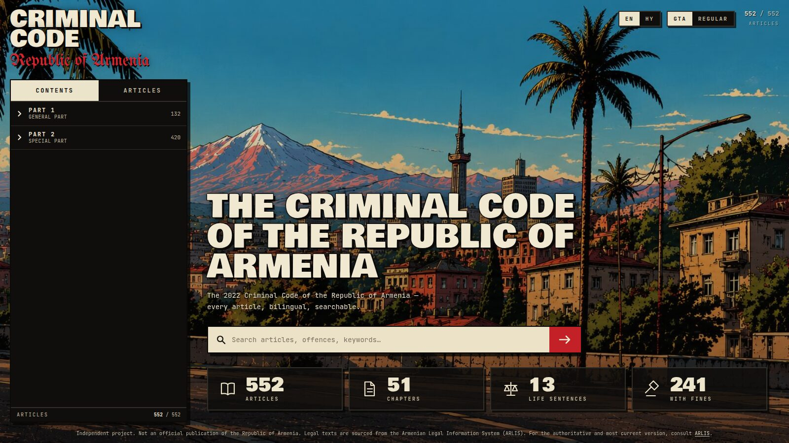
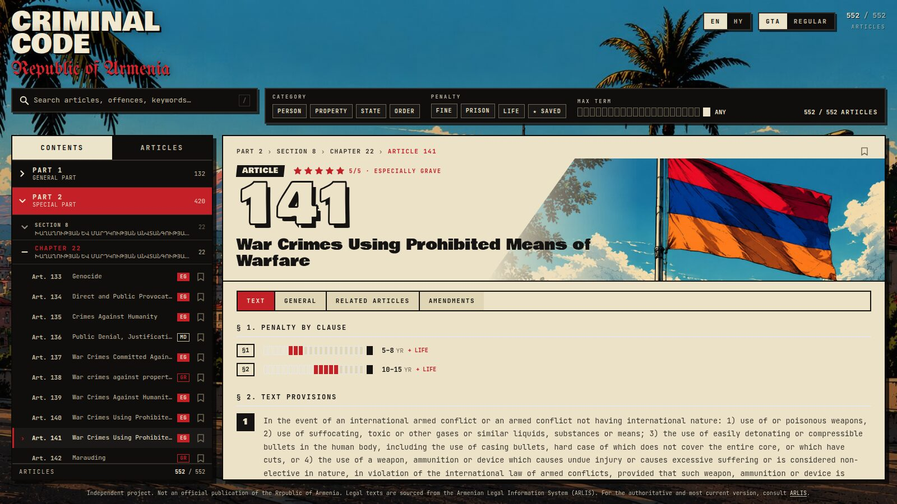
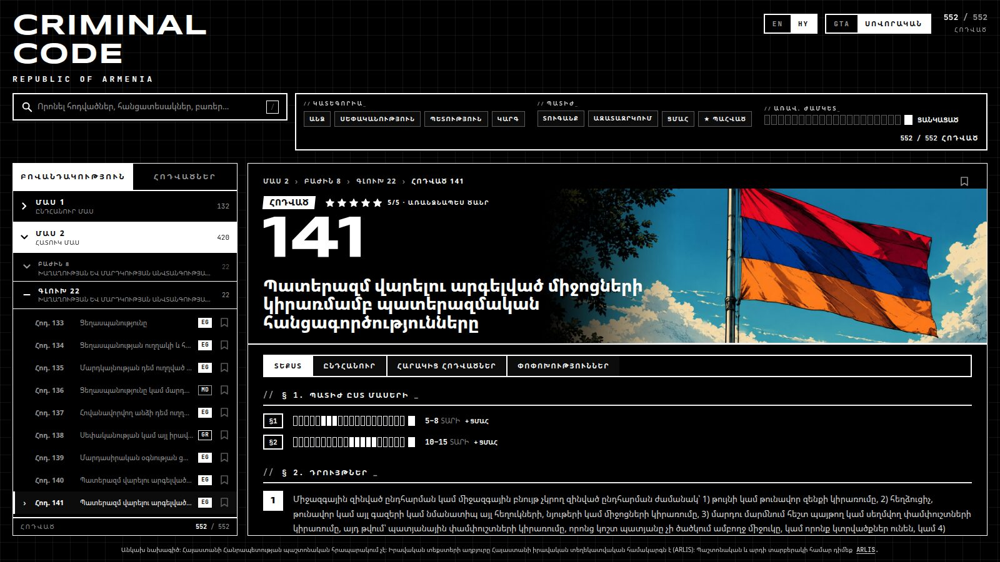

<p align="center">
  
</p>

<h1 align="center">Criminal Code — Republic of Armenia</h1>

<p align="center">
  The 2022 Criminal Code of the Republic of Armenia — every article, bilingual
  (Armenian / English), searchable, with penalty gauges, filters and bookmarks.
  Dressed up as a GTA title screen, with a black-and-white brutalist skin on the side.
</p>

<p align="center">
  <a href="LICENSE"></a>
  
  
  
  
</p>

> ⚠️ **Important**
>
> **Independent project. Not an official publication of the Republic of
> Armenia. Legal texts are sourced from the Armenian Legal Information System
> (ARLIS). For the authoritative and most current version, consult
> [ARLIS](https://www.arlis.am).**

---

## Screenshots

| GTA — title screen | GTA — article |
| --- | --- |
|  |  |

| REGULAR — article (Armenian) |
| --- |
|  |

## Features

- **552 articles, both official languages.** Switch EN ⇄ HY anywhere; the
  language lives in the URL (`/en/141` ⇄ `/hy/141`) so links carry it.
- **Search** by number, offence or keyword (Fuse.js, fuzzy), with a ranked
  hit list.
- **Filters** — category (person / property / state / order), penalty type
  (fine / prison / life), maximum custodial term, and your own bookmarks.
- **Per-clause penalty gauges** — one 0–20-year bar per clause, with life and
  fine markers, never a merged average.
- **Severity at a glance** — stamps (`EG · GR · MD · MN · FINE`) and a 5-star
  meter; a 5/5 slams in and glows so you can't miss it.
- **Article sheet** with `TEXT · GENERAL · RELATED ARTICLES · AMENDMENTS`
  tabs, cross-references in both directions, and a readout strip.
- **Bookmarks** (local to your browser) with a `★ SAVED` filter.
- **Two skins**, remembered per device, `?theme=gta|regular` in the URL too.
- Keyboard: `/` focuses search, `Esc` clears it, type a number to jump.
- Responsive down to phone widths; animations respect `prefers-reduced-motion`.

## Themes

| | GTA (default) | REGULAR |
| --- | --- | --- |
| Mood | Title screen over a Yerevan skyline; cream paper sheets, black sidebar, red stamps | Cyber-brutalist: pure black, 1 px white rules, `//LABEL_` captions |
| Display face | Bowlby One + UnifrakturMaguntia | Syncopate (wide) |
| Imagery | Full-colour illustrations | 1-bit dithered skyline; the flag stays in colour |

All colours and faces are CSS variables keyed off `html[data-theme]`
(`src/index.css`). Components only use semantic tokens — `paper`, `ink`,
`accent`, `side-*` — and never branch on the theme.

### Fonts (all open source)

| Role | Face | Licence |
| --- | --- | --- |
| Headline / numerals (GTA) | [Bowlby One](https://fonts.google.com/specimen/Bowlby+One) | OFL |
| Blackletter subtitle (GTA) | [UnifrakturMaguntia](https://fonts.google.com/specimen/UnifrakturMaguntia) | OFL |
| Wide display (REGULAR) | [Syncopate](https://fonts.google.com/specimen/Syncopate) | OFL |
| Body / data labels | [JetBrains Mono](https://www.jetbrains.com/lp/mono/) | OFL |
| All Armenian text | [Noto Sans Armenian](https://fonts.google.com/noto/specimen/Noto+Sans+Armenian) | OFL |

Armenian is never rendered in a Latin-only face — `<Txt>` routes every
dynamic string to the right font.

## Getting started

```bash
npm install --include=dev
npm run dev        # http://localhost:5173
```

```bash
npm run lint       # eslint
npm run build      # tsc -b && vite build  → dist/
npm run preview    # serve dist/
```

Before a production build, set the deployed origin so link previews get an
absolute image URL:

```bash
# .env
VITE_SITE_URL=https://your-domain.example
```

## How it's put together

```
src/
├── App.tsx                 routes: / → /en, /:lang, /:lang/:articleNumber
├── theme-context.tsx       data-theme on <html>, persisted; hands image URLs to CSS
├── console-context.tsx     query, filters, bookmarks, tree, sidebar tab
├── index.css               theme tokens, skins, motion
├── lib/
│   ├── articles.ts         data access, tree, severity classes, stats
│   ├── search.ts           Fuse index
│   ├── i18n.ts             every UI string, en + hy
│   └── filters.ts
├── components/             header, filter deck, sidebar, gauges, stars, …
├── pages/                  browse-panel (landing / results), article-panel
├── data/articles.json      the Code (from ARLIS)
└── assets/                 illustrations
```

**Routes**

- `/` → redirects to `/en`
- `/:lang` → title screen, or results when a search / filter is live
- `/:lang/:articleNumber` → article (e.g. `/hy/299`)

**Layout**

- **Header** — wordmark, search box with the filter deck beside it (folds
  behind a FILTERS toggle on phones), EN/HY and GTA/REGULAR switches.
- **Landing** — the idle title screen has no paper sheet: title, lead, a hero
  search bar and four stat tiles sit straight on the skyline. Typing fills a
  draft; the arrow (or Enter) commits it and fades the results in.
- **Sidebar** — `CONTENTS` (Part → Section → Chapter → Article tree with
  counts) and `ARTICLES` (the ranked hit list).
- **Sheet** — article hero with the flag, 5-star meter, tabs, readout strip.
- **Footer** — the provenance note above, on every page, in both languages.

**Motion** — article open/close cross-fades via the View Transitions API
(React Router `viewTransition`), with a plain fade-in fallback; stars pop in,
a 5/5 slams and glows twice; everything is off under `prefers-reduced-motion`.

## Data

`src/data/articles.json` holds all 552 articles with provisions, per-clause
penalties, an aggregate penalty envelope, category and cross-references, as
parsed from ARLIS. Hierarchy labels (sections, chapters) are Armenian-only in
the source; the two Parts carry English labels. The original PDFs of the Code
are in the repository root for reference.

## Contributing

See [CONTRIBUTING.md](CONTRIBUTING.md) for the commit convention
(Conventional Commits: `feat:`, `bugfix:`, `hotfix:`, `docs:`, `style:`,
`refactor:`, `chore:`) and branch naming (`feat/123-short-purpose`).

Design references for the three screens live in `design/`.

## License

[MIT](LICENSE) for the code. The legal texts are official acts published by
ARLIS and are not covered by the licence; the illustrations are the project's
own artwork — see the scope note in `LICENSE`.
